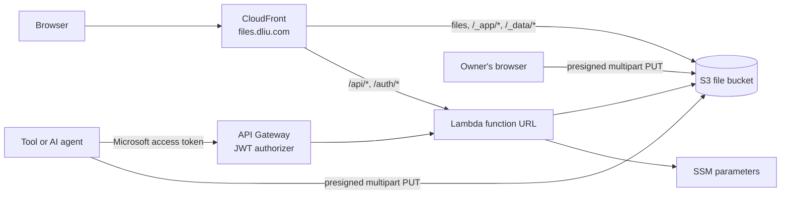

# files.dliu.com

A small, serverless file host. The owner uploads, moves and deletes files after signing in with Microsoft 365. Anyone can browse the folders and download the files, and every file has a permanent, readable link such as `https://files.dliu.com/me/resume.pdf`.

Tools, scripts and AI agents can manage files with Microsoft-issued access tokens. The [API reference](https://files.dliu.com/docs/api) documents the eight routes, their scopes, schemas, upload workflow and errors. Agents should read the plain Markdown at [/docs/api.md](https://files.dliu.com/docs/api.md); the browser page renders that same file.

## How it works



The architecture is the same as [video.dliu.com](https://github.com/dliu-com/video).

- **Files live at their own paths.** `me/resume.pdf` is stored under the S3 key `me/resume.pdf` and served at `https://files.dliu.com/me/resume.pdf`. CloudFront caches files and answers byte-range requests.
- **Folders are pages.** Any URL ending in `/` (and `/` itself) shows the file browser. A CloudFront Function rewrites it to `/_app/index.html`, which reads the folder from the address bar. A folder URL without the trailing slash redirects to it. Missing files get the same page with a "not found" message and status 404.
- **There is no database.** `_data/files.json` lists every file (path, size, type, modified). It is both the public listing and the source of truth, and the API updates it with conditional writes. Folders exist only as path prefixes, so empty folders are not saved.
- **Uploads go straight from the browser to S3** using presigned multipart URLs. Parts are at least 16 MiB, four upload in parallel, and failed parts are retried. Files are uploaded one at a time. You can pick files or a whole folder, or drag and drop them. Uploading over an existing file asks first.
- **Moves and renames** copy inside S3 (in parallel parts for files over 256 MiB), update the listing, then delete the originals. A folder with up to 200 files can be moved at once.
- **Caching.** Files are kept for 1 day at CloudFront's edges (`s-maxage=86400`, plus a day of `stale-while-revalidate`) and for 5 minutes in browsers. The distribution uses every edge location (price class All) and HTTP/3. See [Caching and CDN clearing](#caching-and-cdn-clearing).
- **Sign-in** uses Entra OIDC with PKCE, the same as video and traffic-monitor. Only accounts in the root domain (`@dliu.com`) can manage files.
- **Security.** The bucket is private (CloudFront reads it with OAC). Scripts may only run from `/_app/`, so an uploaded HTML or SVG file cannot run code on the site. Pages and files may be framed by `https://dliu.com` and `https://*.dliu.com` only. The site was threat-modelled, penetration-tested and code-reviewed live on 3 November 2026 (website `/api/*` and `/auth/*`, the managed Microsoft API, presigned uploads, reserved paths, CSP and headers, direct S3/Lambda/`*.cloudfront.net` access, cache deception, CRLF, denial-of-wallet and supply chain); the tests, expected and actual results, the threat model, the denial-of-wallet caps and a code-review summary (npm audit, secret scan, IAM least privilege) are in `/docs` under Security. Two findings were fixed: (1) a critical flaw where the short-lived sign-in cookie could be replayed as a session cookie — after the fix every pre-fix owner session is invalid, so the owner must sign in again; and (2) the API could write the shared `dliu.com/` prefix that every dliu.com site loads (e.g. `dl.css`). The website now treats `dliu.com/` as read-only and its Lambda role is explicitly IAM-denied `PutObject`/`DeleteObject`/`AbortMultipartUpload` on `dliu.com/*` and `_app/*`; a separate managed-API function and role (used only by the shared-resources publisher, with a Microsoft `files.write` token) may write `dliu.com/*` so the shared listing stays accurate, and it keeps the `_app/*` Deny. The completed-upload size is also checked against the declared size to bound cost abuse.
- Page views and downloads are logged by the shared traffic-monitor visitor function and geo origin request policy.
- **Shared look.** Every page (the file browser, `/docs`, `/docs/api` and the sign-in error page) uses the shared dliu.com kit: the Files folder logo (`web/logo.svg`) top left and as favicon, the DL logo at the start of the footer, the `dliu.com · Docs` footer link (to `/docs`), `https://files.dliu.com/dliu.com/ui/v1/dl.css` loaded before `/_app/style.css`, and `dl-docs.css` with the same five `dl-tabs` (Technical architecture, Cost, Security, Testing, API) on both docs pages. A shared Chinese/English language switch (`dl-language`, last in the nav) runs on every page: `web/i18n.js` mounts the switcher before the module scripts, the choice is stored in `localStorage` and defaults to the browser language, and `web/common.js` exports `t()`/`onLanguageChange()` so the file browser and the docs pages redraw in the chosen language (`docs/api.md` for agents stays English). `/docs` uses the same diagram kit as the other sites (`web/diagram.js`). `web/style.css` keeps only file-browser rules (breadcrumbs, toolbar, file table, upload progress, drop hint, toast) on the shared `--dl-*` variables. The kit is served from this same origin, so the CSP (`style-src 'self'`, `img-src 'self'`) needs no change and scripts still run only from `/_app/`. The bucket's `dliu.com/` folder is read-only to the website and is published through the managed API (see [Reserved names](#reserved-names)); do not edit or delete it from the file browser. `test/shared-ui.test.js` guards the markup and stylesheet.

### Caching and CDN clearing

Other dliu.com sites load files from here, so files are cached close to visitors for a day. Changes still show within seconds because the bucket clears itself:

| What | Edge (CloudFront) | Browser | How a change is cleared |
| --- | --- | --- | --- |
| Files (`<path>`) | 1 day, then up to 1 more day served stale while refreshing | 5 minutes | Automatically, whenever a file is replaced or deleted in S3 by any route |
| Site pages, scripts, styles (`_app/`) | `no-cache`: revalidated with S3 on every load | revalidated | Not needed; a deploy shows at once |
| File listing (`_data/files.json`) | `no-cache`: revalidated with S3 on every load | revalidated | Not needed; changes show at once |
| `api/*`, `auth/*` | Not cached | Not cached | n/a |

**Decision: automatic clearing is on for this bucket.** It is the only dliu.com bucket whose public files are changed outside a deploy, both by this app and by hand in the S3 console. S3 sends every change to EventBridge, and the rule (`FileChangedRule`) invokes `lambda/api/clear.js`, which invalidates the file's URL (encoded the way browsers send it) within seconds:

- **Replaced or deleted files** are cleared, one path each. A file uploaded to a new path is skipped, because CloudFront never had it; so are `_app/`, `_data/` and lifecycle clean-up of old versions.
- **Budget.** The first 1,000 invalidation paths a month are free across the whole AWS account, then $0.005 each. Normal use here is a handful of paths a month. Changes made in the app are cleared twice (once by the API, once automatically), and deleting or moving a folder in the S3 console clears one path per file, so avoid bulk console edits of thousands of files.
- **Limits.** Browsers may keep a changed file for up to 5 minutes. Clearing takes effect at the edges in under a minute. If an invalidation fails, EventBridge retries it for up to an hour; after that, run `aws cloudfront create-invalidation --distribution-id <id> --paths '/<path>'`.
- **Not needed elsewhere.** The other dliu.com sites change their buckets only through deploys, which already clear their caches; each records its own decision in its README.

### Reserved names

These top-level names belong to the site and cannot be used for files or folders: `_app`, `_data`, `api`, `auth` and `index.html`. The exact paths `docs`, `docs/api` and `docs/api.md` are docs pages and `docs/health.md` is the testing Markdown, so no file can use them; `docs/health` is reserved too (it 301-redirects to the Testing tab). A `docs/` folder and other files under it are fine. Names may contain spaces, Unicode and most punctuation, but not `\ ? # %` or control characters.

The top-level `dliu.com` prefix holds the shared assets every dliu.com site loads. It is **read-only to the website**: signed-in website sessions cannot upload, replace, move or delete anything under it (the browser hides those controls and the server refuses them), and the website Lambda role is IAM-denied writing `dliu.com/*`. It is writable **only** through the managed API — a Microsoft token with the `files.write`/`files.delete` scopes, served by a separate function and role that keeps the `_app/*` Deny — so the shared-resources publisher can update it and keep `_data/files.json` accurate.

### Costs

Nothing runs while nobody is using the site, and there is no fixed monthly fee. There are no servers, load balancers, NAT gateways, databases or WAF.

| Resource | You pay for |
| --- | --- |
| S3 | Storage (Intelligent-Tiering for files; old versions are kept for 30 days) and requests |
| CloudFront | Data transfer and requests. The free tier includes 1 TB and 10M requests per month. |
| Lambda | Invocations. Only sign-in, the owner's uploads, moves and deletes, and clearing changed files use it. |
| EventBridge, CloudFront invalidations | S3 change events are free. Invalidations are free for the first 1,000 paths a month per account. |
| API Gateway (HTTP API) | Managed API requests only, per million requests |
| SSM Parameter Store | Standard parameters, which are free |
| Route 53, ACM | Covered by the existing hosted zone; public certificates are free |

When idle, the only cost is file storage.

## Layout

| Path | What |
| --- | --- |
| `lib/file-server-stack.ts` | The CDK stack |
| `lambda/api/` | API and sign-in Lambda (`index.js` routes, `routes.json` managed routes and scopes, `api-access.js` Microsoft token checks, `files.js` upload/move/delete, `store.js` S3 listing, `auth.js` Entra, `presign.js` SigV4, `clear.js` clears changed files from CloudFront) |
| `functions/pages.js` | CloudFront Function that serves the file browser for folder URLs, the docs page at `/docs` and the API reference at `/docs/api` |
| `web/` | The file browser, the docs page (`docs.html`, `docs.js`, `diagram.js`: architecture, cost and security) and API reference page (`docs-api.html`, `docs-api.js` render `docs/api.md`), deployed to `_app/` in the bucket. `style.css` holds only app-specific rules; the shared look comes from dl.css |
| `config/site.json` | Subdomain, sites allowed to frame the site, upload size cap, managed API switch |
| `scripts/set-secrets.sh` | Stores the Entra app credentials in SSM |
| `scripts/api-client.js` | Managed API requester for an auth.dliu.com token |

## Setup

Requirements: the root `dliu.com` stack (exports `MainDomain`, `MainHostedZoneId`) and traffic-monitor (exports `TrafficVisitorFunctionArn`, `TrafficGeoOriginRequestPolicyId`) must already be deployed in eu-west-1.

1. In the Microsoft Entra app registration, add the **Web** redirect URI `https://files.dliu.com/auth/callback`, and create a client secret. The video site's app registration can be reused. Optionally, set *Enterprise applications → (the app) → Assignment required = Yes* and assign only the people who may upload.
2. Store the app credentials (prompts for tenant ID, client ID and client secret; the secret is not echoed):

   ```sh
   make set-secrets
   ```

   They go to SSM as `/files/entra-tenant-id`, `/files/entra-client-id` and `/files/entra-client-secret` (SecureString). Run it again any time to rotate the secret.
3. Install and deploy:

   ```sh
   make install
   make deploy      # runs the unit tests first
   make outputs
   make smoke       # end-to-end test against the live site
   ```

Then open https://files.dliu.com, choose **Sign in**, and upload.

## Microsoft-issued API access

The managed API uses Microsoft-issued access tokens for the shared **dliu API** Entra resource, not the Files website's sign-in. **Authentication is required:** configure your requester using the [Auth API documentation](https://auth.dliu.com/docs/api), the canonical guide for token acquisition, the default `~/.dliu_token` file, expiry and bearer transport. Website sign-in, session cookies and public downloads are unchanged, and Files creates no API tokens.

An API Gateway HTTP API validates the token's signature, tenant-specific v2 issuer, audience, expiry and the route's delegated scope. The Lambda accepts this identity only from the configured gateway, checks tenant, audience, the approved client `azp`, the user and the shared Microsoft-issued `api.access` user role ("dliu API user"), checks the route scope again, and never falls back to a website cookie. Website `/api/*` requests still need the session cookie and, for changes, the same-origin check. Arbitrary headers cannot supply a gateway identity.

| API routes | Required delegated scope |
| --- | --- |
| `GET /api/me`, `GET /api/files` | `files.read` |
| `POST /api/uploads`, `/api/uploads/parts`, `/api/uploads/complete`, `/api/uploads/abort` | `files.write` |
| `POST /api/files/move` | `files.write` |
| `POST /api/files/delete` | `files.delete` |

`files.write` does not include `files.delete`. Access is controlled by Entra user assignment to the shared **dliu API user** role (`api.access`), which every dliu managed API requires but which grants no scope by itself. Only the owner's designated standard account is assigned. Other organisation users keep normal website access, but website sign-in never grants API rights: without the role assignment their tokens are refused. Unlike website sign-in, the managed API does not also check for an `@dliu.com` address.

**Accepted residual risk (F5).** The managed API authorises by the shared `api.access` role rather than a Files-specific role or an `oid` allow-list, so anyone assigned that role can write and delete files. This is accepted: Entra is the gate — **Assignment required** with the role assigned only to the owner's account — and the role is shared across dliu apps by design, so no per-app role or allow-list is added. (F4, that `files.write` can overwrite or move existing files without `files.delete`, stays as documented above.)

### Entra and SSM configuration

1. On the shared **dliu API** registration (v2 access tokens), define admin-consent delegated scopes `files.read`, `files.write` and `files.delete`. The shared user-only app role **dliu API user** (`api.access`) is used by all dliu managed APIs; with **Assignment required** on its enterprise application, assign it only to the owner's designated standard account.
2. Store these non-secret **String** parameters in eu-west-1, with values from the [Auth API documentation](https://auth.dliu.com/docs/api):

   | Parameter | Value |
   | --- | --- |
   | `/files/api-tenant-id` | The Entra directory ID |
   | `/files/api-audience` | The shared dliu API application/client ID (a GUID, without `api://`) |
   | `/files/api-client-id` | The same ID: the only approved SPA client (`azp`) |

3. With `microsoftApi: true` in `config/site.json`, deploy and read `MicrosoftApiUrl` from `make outputs`. The deployment fails if the parameters are missing; set `microsoftApi` to `false` to deploy without the managed API.

Use `MicrosoftApiUrl` for bearer requests, not `https://files.dliu.com/api/*`. The deployment writes it into the published API reference. The gateway has no default, sign-in or logout route.

### Request examples

With a token configured per the Auth API documentation, Node.js 22+ and `npm ci`, from this checkout:

```bash
export FILES_API_URL='https://<api-id>.execute-api.eu-west-1.amazonaws.com' # MicrosoftApiUrl
node scripts/api-client.js GET /api/me
node scripts/api-client.js GET /api/files
node scripts/api-client.js POST /api/files/move '{"from":"me/old.pdf","to":"me/new.pdf"}'
```

The client reads the token file on every request, only calls the routes above and never follows redirects. Uploads send file bytes straight to S3 with presigned URLs; see the [API reference](https://files.dliu.com/docs/api) for the workflow.

A `401` means the token or endpoint is wrong or expired; a `403` means the client, the `api.access` assignment or the route scope is missing.

Managed Files code does not cache bearer tokens in application-global state, persist them, or log bearer headers or full request events. Request-local values and warm-runtime memory may remain until garbage collection; no forensic zeroization is promised. Upload tokens are signed with a key derived from the website client secret, so upload routes on the managed API also read `/files/entra-*`; reads, moves and deletes do not.

## Moving from the old version

The old version served a static bucket that was synced from this repo, with Jenkins. This version starts with a new, empty bucket:

- Deploying keeps the CloudFront distribution (and its ID, which traffic-monitor uses), the certificate and the DNS records.
- The old bucket is removed from the stack but **retained**, with its files, as a backup. Delete it in the S3 console once you no longer need it.
- Re-upload the old files with **Upload folder** or drag and drop, keeping their paths so existing links keep working. Other dliu.com sites link to `https://files.dliu.com/dliu.com/favicon.png`.

## Public health check

[status.dliu.com](https://status.dliu.com) tests the site as an anonymous guest, with no sign-in and no AWS access. Two surfaces support it:

- **`GET /health`** — a public, read-only endpoint outside `/api/`. CloudFront's `health` behaviour forwards no cookies, `Authorization` header or query string, and the handler reads none of them. It runs one cheap read per dependency (an S3 `HeadObject` of the file-list key for `storage`, and the SSM Entra config load for `signin`), each with a 3 s timeout, in parallel. It returns `application/health+json` cached 60 s, `200` when every function is `pass`/`warn` and `503` on `fail`, as `{status, time, functions:[{key, name, status, output?}]}`. It reveals nothing private: `output` is a generic reason such as `timeout` or `read failed`.
- **`/docs#health`** — the **Testing** tab on the `/docs` page (shared docs look), with a diagram of how the site is tested, a plain-language line per function and folded technical details. The old `/docs/health` path 301-redirects here. The full machine-readable version is at **[/docs/health.md](https://files.dliu.com/docs/health.md)**, which is enough on its own to implement the guest checks. `test/health.test.js` keeps the tab, the Markdown and the endpoint in sync.

## Testing

```sh
make test     # unit tests (Jest): API, managed API access, API client, API docs, auth, presigner, CloudFront Function, stack
make synth
make diff
make smoke    # end-to-end against the deployed site
```

`make smoke` (`scripts/smoke-test.js`) uploads a throwaway 20 MiB file in two parts straight to S3 into a random `smoke-test-*` folder. It checks CORS, byte-range serving, the listing, the folder page and its CSP, and the 404 for missing files. Then it moves the file and deletes the folder. It signs a 10-minute owner session with the key derived from the client secret in SSM, so it needs AWS credentials that can read `/files/*`. Use `node scripts/smoke-test.js --keep` to leave the file in place for a look in the browser.

## Traffic monitoring

The site is registered in traffic-monitor as `files` (`config/sites.json` there, with the distribution ID in its local distributions file). If the distribution is ever replaced, update the ID there and redeploy traffic-monitor.

## Notes

- The bucket is versioned: deleted or replaced files can be restored from the S3 console for 30 days. The listing is not restored automatically; re-upload a restored file, or move it, to list it again.
- Unfinished multipart uploads are aborted by S3 after 2 days.
- The bucket is retained if the stack is deleted.
- The site uses a light theme only and adapts from small phones to wide screens.
