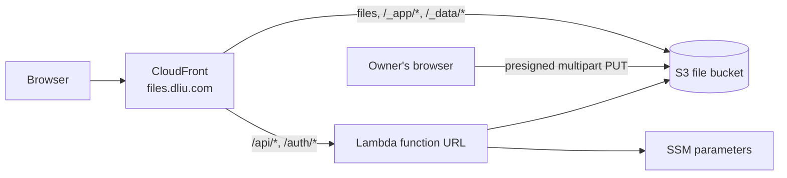

# files.dliu.com

A small, serverless file host. The owner uploads, moves and deletes files after signing in with Microsoft 365. Anyone can browse the folders and download the files, and every file has a permanent, readable link such as `https://files.dliu.com/me/resume.pdf`.

## How it works



The architecture is the same as [video.dliu.com](https://github.com/dliu-com/video).

- **Files live at their own paths.** `me/resume.pdf` is stored under the S3 key `me/resume.pdf` and served at `https://files.dliu.com/me/resume.pdf`. CloudFront caches files and answers byte-range requests.
- **Folders are pages.** Any URL ending in `/` (and `/` itself) shows the file browser. A CloudFront Function rewrites it to `/_app/index.html`, which reads the folder from the address bar. A folder URL without the trailing slash redirects to it. Missing files get the same page with a "not found" message and status 404.
- **There is no database.** `_data/files.json` lists every file (path, size, type, modified). It is both the public listing and the source of truth, and the API updates it with conditional writes. Folders exist only as path prefixes, so empty folders are not saved.
- **Uploads go straight from the browser to S3** using presigned multipart URLs. Parts are at least 16 MiB, four upload in parallel, and failed parts are retried. Files are uploaded one at a time. You can pick files or a whole folder, or drag and drop them. Uploading over an existing file asks first.
- **Moves and renames** copy inside S3 (in parallel parts for files over 256 MiB), update the listing, then delete the originals. A folder with up to 200 files can be moved at once.
- **Replaced, moved and deleted files** are invalidated in CloudFront. Files are cached for 5 minutes, so even a missed URL spelling catches up quickly.
- **Sign-in** uses Entra OIDC with PKCE, the same as video and traffic-monitor. Only accounts in the root domain (`@dliu.com`) can manage files.
- **Security.** The bucket is private (CloudFront reads it with OAC). Scripts may only run from `/_app/`, so an uploaded HTML or SVG file cannot run code on the site. Pages and files may be framed by `https://dliu.com` and `https://*.dliu.com` only.
- Page views and downloads are logged by the shared traffic-monitor visitor function and geo origin request policy.

### Reserved names

These top-level names belong to the site and cannot be used for files or folders: `_app`, `_data`, `api`, `auth` and `index.html`. Names may contain spaces, Unicode and most punctuation, but not `\ ? # %` or control characters.

### Costs

Nothing runs while nobody is using the site, and there is no fixed monthly fee. There are no servers, load balancers, NAT gateways, databases or WAF.

| Resource | You pay for |
| --- | --- |
| S3 | Storage (Intelligent-Tiering for files; old versions are kept for 30 days) and requests |
| CloudFront | Data transfer and requests. The free tier includes 1 TB and 10M requests per month. |
| Lambda | Invocations. Only sign-in and the owner's uploads, moves and deletes use it. |
| SSM Parameter Store | Standard parameters, which are free |
| Route 53, ACM | Covered by the existing hosted zone; public certificates are free |

When idle, the only cost is file storage.

## Layout

| Path | What |
| --- | --- |
| `lib/file-server-stack.ts` | The CDK stack |
| `lambda/api/` | API and sign-in Lambda (`index.js` routes, `files.js` upload/move/delete, `store.js` S3 listing, `auth.js` Entra, `presign.js` SigV4) |
| `functions/pages.js` | CloudFront Function that serves the file browser for folder URLs |
| `web/` | The file browser, deployed to `_app/` in the bucket |
| `config/site.json` | Subdomain, sites allowed to frame the site, upload size cap |
| `scripts/set-secrets.sh` | Stores the Entra app credentials in SSM |

## Setup

Requirements: the root `dliu.com` stack (exports `MainDomain`, `MainHostedZoneId`) and traffic-monitor (exports `TrafficVisitorFunctionArn`, `TrafficGeoOriginRequestPolicyId`) must already be deployed in eu-west-1.

1. In the Microsoft Entra app registration, add the **Web** redirect URI `https://files.dliu.com/auth/callback`, and create a client secret. The video site's app registration can be reused. Optionally, set *Enterprise applications → (the app) → Assignment required = Yes* and assign only the people who may upload.
2. Store the app credentials (prompts for tenant ID, client ID and client secret; the secret is not echoed):

   ```sh
   make set-secrets
   ```

   They go to SSM as `/files/entra-tenant-id`, `/files/entra-client-id` and `/files/entra-client-secret` (SecureString). Run it again any time to rotate the secret.
3. Install and deploy:

   ```sh
   make install
   make deploy      # runs the unit tests first
   make outputs
   make smoke       # end-to-end test against the live site
   ```

Then open https://files.dliu.com, choose **Sign in**, and upload.

## Moving from the old version

The old version served a static bucket that was synced from this repo, with Jenkins. This version starts with a new, empty bucket:

- Deploying keeps the CloudFront distribution (and its ID, which traffic-monitor uses), the certificate and the DNS records.
- The old bucket is removed from the stack but **retained**, with its files, as a backup. Delete it in the S3 console once you no longer need it.
- Re-upload the old files with **Upload folder** or drag and drop, keeping their paths so existing links keep working. Other dliu.com sites link to `https://files.dliu.com/dliu.com/favicon.png`.

## Testing

```sh
make test     # unit tests (Jest): API, auth, presigner, CloudFront Function, stack
make synth
make diff
make smoke    # end-to-end against the deployed site
```

`make smoke` (`scripts/smoke-test.js`) uploads a throwaway 20 MiB file in two parts straight to S3 into a random `smoke-test-*` folder. It checks CORS, byte-range serving, the listing, the folder page and its CSP, and the 404 for missing files. Then it moves the file and deletes the folder. It signs a 10-minute owner session with the key derived from the client secret in SSM, so it needs AWS credentials that can read `/files/*`. Use `node scripts/smoke-test.js --keep` to leave the file in place for a look in the browser.

## Traffic monitoring

The site is registered in traffic-monitor as `files` (`config/sites.json` there, with the distribution ID in its local distributions file). If the distribution is ever replaced, update the ID there and redeploy traffic-monitor.

## Notes

- The bucket is versioned: deleted or replaced files can be restored from the S3 console for 30 days. The listing is not restored automatically; re-upload a restored file, or move it, to list it again.
- Unfinished multipart uploads are aborted by S3 after 2 days.
- The bucket is retained if the stack is deleted.
- The site uses a light theme only and adapts from small phones to wide screens.
